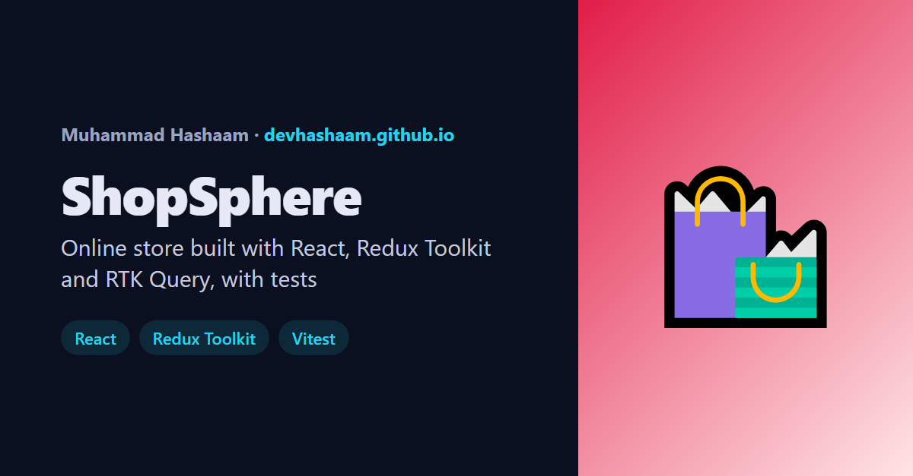

# ShopSphere

An online store built with **React 18, Redux Toolkit, RTK Query and React Router**, with tests in **Vitest and React Testing Library**.

**Live demo:** https://devhashaam.github.io/shopsphere/



## Features

- **Server-side search, category filter, sorting and pagination** against the [DummyJSON](https://dummyjson.com/) REST API (194 products)
- **Filters live in the URL** (`?q=phone&sort=price-asc&page=2`), so results are shareable and the back button works
- **Product pages** with an image gallery, stock levels, specs and reviews
- **Cart** with quantity limits based on stock, free shipping over $100, and persistence in `localStorage`
- **Fast:** cached API responses, a product detail is prefetched on hover, images lazy-load with fixed dimensions (no layout shift), and old results are dimmed instead of a loading flash
- **Accessible:** semantic HTML, labelled controls, keyboard friendly, live regions for counts, `prefers-reduced-motion`
- Loading skeletons, error states with retry, and empty states everywhere

## Tech and why

| Need | Choice | Why |
|---|---|---|
| UI | React 18 + Vite | Fast dev server and small production build |
| Global state | Redux Toolkit (`createSlice`, `createSelector`) | Predictable cart state, Immer for simple updates, memoised selectors |
| Server state | RTK Query | Caching, request de-duplication, loading/error flags and prefetching built in |
| Routing | React Router 6 | URL-driven filters, product and cart pages |
| Tests | Vitest + React Testing Library | Jest-compatible API, tests behaviour the way a user sees it |
| CI/CD | GitHub Actions → GitHub Pages | Every push runs the tests; it only deploys if they pass |

## Project structure

```
src/
  app/            store.js (Redux store factory + cart persistence), router.js
  features/cart/  cartSlice.js (reducers + selectors) and its tests
  services/       productsApi.js (RTK Query endpoints) and its tests
  hooks/          useDebounce.js and its tests
  components/     Header, ProductCard, Filters, Pagination, QuantityStepper, Rating, StatusViews
  pages/          CatalogPage, ProductPage, CartPage, NotFoundPage
  test/           setup + renderWithProviders helper
```

## Run it locally

```bash
npm install
npm run dev     # http://localhost:5173/shopsphere/
npm test        # 19 tests
npm run build
```

## Tests

19 tests across 5 files cover the cart reducer and selectors (stock limits, totals rounded to cents), the debounce hook (with fake timers), URL building for the API, pagination, and user flows in the product card and cart page (adding to cart, shipping rules, removing items, placing an order).

---

Built by [Muhammad Hashaam](https://devhashaam.github.io/) · Product data from DummyJSON · No real orders are placed.
